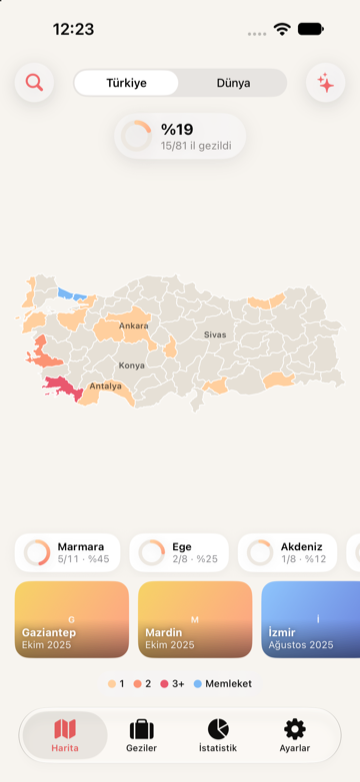
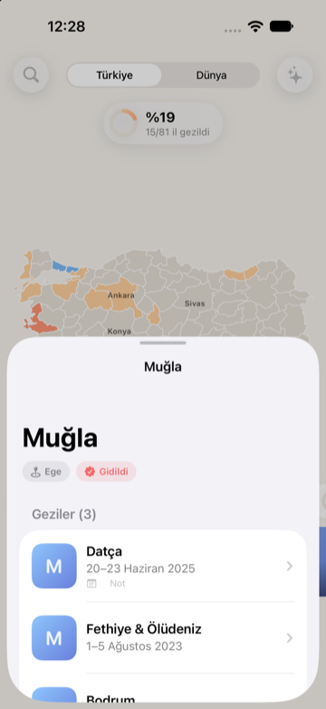
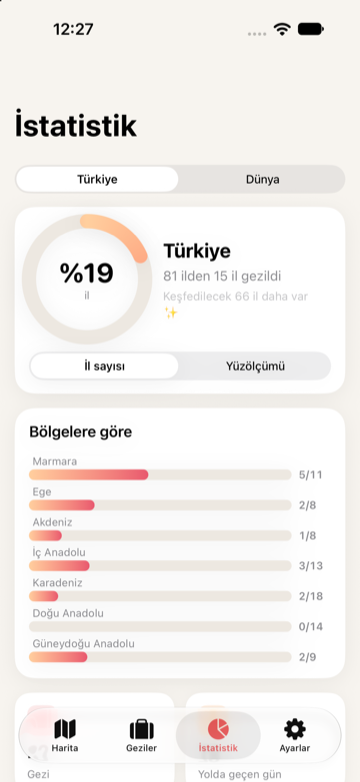
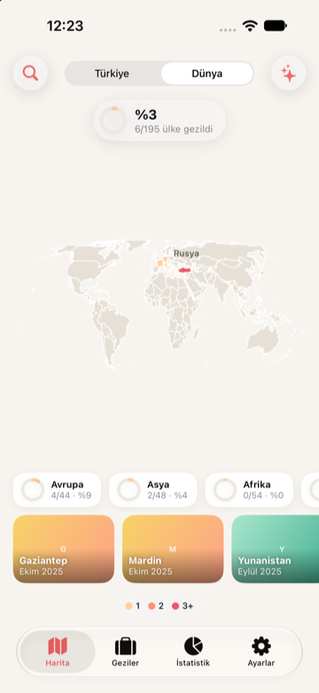
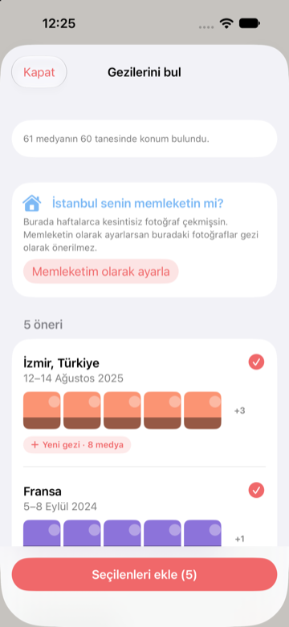
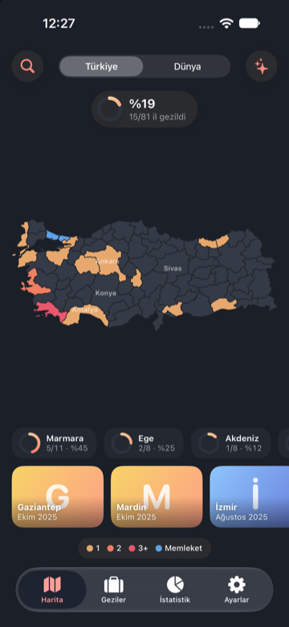

# Trip 🗺️

Gezdiğin yerleri haritada boyayan, her şehre tarihli geziler, fotoğraflar, videolar ve notlar iliştirebildiğin bir iOS uygulaması. SwiftUI + SwiftData, tamamen cihaz üzerinde çalışır.

<p>
  
  
  
  
</p>
<p>
  
  
  
</p>

## Özellikler (MVP)

- **Harita seç:** Türkiye (81 il) veya Dünya (BM'nin 195 ülkesi). Gezdikçe harita boyanır; renk koyuluğu gezi sayısını gösterir (1 / 2 / 3+), memleketin mavi görünür. Türkiye'de bir il gezince dünya haritasında Türkiye de boyanır.
- **İşaretle ve gezi aç:** Bir ile/ülkeye dokun (ya da ara), "gittim" diye işaretle, aynı yere farklı tarihlerde istediğin kadar gezi ekle.
- **Fotoğraf, video, not:** Galeriden medya ekle, notlar yaz, kapak fotoğrafı seç. Önce fotoğraf seçersen yer ve tarihler fotoğraflardan otomatik dolar.
- **İlerleme ve grafikler:** İl/ülke sayısına veya yüzölçümüne göre yüzde, 7 coğrafi bölge / kıta bazında çubuklar, yıllara göre geziler, öne çıkanlar (en çok gidilen, en uzun gezi, son keşif…).
- **Fotoğraflardan otomatik gezi bulma:** Galerideki konum + tarih bilgisinden gezileri çıkarır, sen onaylarsın.

## Otomatik gezi bulma nasıl çalışır?

Her şey cihazda, internetsiz yapılır (`Packages/TripCore/Sources/TripCore/AutoImport/TripClusterer.swift`):

1. Konumu olan tüm fotoğraf/videolar okunur (PhotoKit, arka planda).
2. Her konum, uygulamaya gömülü il/ülke sınırlarıyla **çevrimdışı** eşleştirilir: grid indeks + point-in-polygon, kıyıda/teknede çekilen fotoğraflar için ~12 km tolerans, ~1 km'lik önbellek. Türkiye önce il düzeyinde, değilse dünya ülkesi olarak çözülür.
3. Fotoğraflar **bölge bölge** zamana göre sıralanır; ardışık iki fotoğraf arası 48 saatten fazlaysa yeni gezi başlar. (Bölge bazında yapıldığı için İzmir tatilinin ortasındaki bir Manisa günübirliği İzmir gezisini bölmez.)
4. 3'ten az fotoğraflı kümeler "yoldan geçiş" sayılıp elenir; 30 günden uzun kesintisiz kümeler "muhtemelen burada yaşıyorsun" diye memleket önerisine dönüşür; memleketin varsayılan olarak hariç tutulur.
5. Mevcut bir geziyle (±1 gün) çakışan kümeler yeni gezi yerine "mevcut geziye N fotoğraf ekle" olarak önerilir; zaten eklenmiş fotoğraflar tekrar önerilmez.

## Mimari

```
Trip/                     iOS uygulaması (SwiftUI, SwiftData, Swift Charts, PhotoKit)
  App/                    giriş noktası, AppState (tercihler), sekmeler
  Models/                 VisitedRegion · Trip · TripMedia (CloudKit uyumlu şema), demo verisi
  Services/               MapPackStore (harita paketleri + çizim geometrisi), PhotoLibrary (PhotoKit)
  Features/               Map · Trips · Stats · AutoImport · Settings
  DesignSystem/           tema (açık/koyu), ortak bileşenler, Türkçe biçimlendirme/arama
  Resources/MapPacks/     turkey.json, world.json (üretilmiş)
Packages/TripCore/        UI'dan bağımsız saf Swift: geometri, Mercator/Equal Earth projeksiyonları,
                          hit testing, çevrimdışı ters geokodlama, istatistikler, kümeleme algoritması
Tools/geodata/            Natural Earth → sadeleştirilmiş harita paketleri (build.sh + pack.py)
Tools/make_test_photos.swift   simülatör için GPS/tarihli test fotoğrafları
TripUITests/              uçtan uca UI testleri
```

- Harita `Canvas` ile çizilir; geometri bir kez "birim uzaya" projekte edilir, yakınlaştırma/kaydırma yalnızca dönüşümü değiştirir (her zoomda keskin çizgiler).
- Fotoğraflar kopyalanmaz: `PHAsset` kimliği + küçük bir önizleme saklanır. Galeriye referans verilemezse (ör. erişim kapalı) küçültülmüş kopya saklanır.
- Yeni harita eklemek = `Tools/geodata` ile yeni bir paket JSON'u üretip `MapPackStore.bundledPackIDs`'e eklemek.

## Geliştirme

Gereksinimler: Xcode 26+ (iOS 18+ hedef), [XcodeGen](https://github.com/yonaskolb/XcodeGen).

```bash
brew install xcodegen
xcodegen generate        # project.yml → Trip.xcodeproj
open Trip.xcodeproj
```

`Trip.xcodeproj` repoda olduğu için XcodeGen olmadan da açılır; dosya ekleyip çıkardıktan sonra `xcodegen generate` çalıştır. Gerçek cihaz için Xcode'da *Signing & Capabilities* altından kendi takımını seç.

### Testler

```bash
# Çekirdek mantık (macOS'ta saniyeler içinde)
cd Packages/TripCore && swift test

# Tüm testler (birim + UI) simülatörde
xcodebuild test -project Trip.xcodeproj -scheme Trip -destination 'platform=iOS Simulator,name=iPhone 18 Pro'
```

Otomatik içe aktarma UI testi için simülatör galerisine test fotoğrafları ekle:

```bash
swift Tools/make_test_photos.swift /tmp/trip-photos
xcrun simctl addmedia booted /tmp/trip-photos/*.jpg
xcrun simctl privacy booted grant photos com.clumsy28.trip
```

### Debug başlatma argümanları

`-seedDemoData` (örnek geziler), `-uiTesting` (bellek içi veri), `-initialTab map|trips|stats|settings`, `-initialPack turkey|world`, `-openRegion turkey:TR-35`, `-openTrip`, `-autoImport`.

### Harita verisini yeniden üretmek

```bash
./Tools/geodata/build.sh   # curl + npx mapshaper + python3
```

## Yol haritası

- İlçe haritaları ("İstanbul'un %40'ını gezdin") ve diğer ülkelerin eyalet haritaları
- iCloud senkronu (şema hazır)
- Birden fazla şehri kapsayan geziler, paylaşılabilir harita görselleri, widget

## Veri

Harita sınırları [Natural Earth](https://www.naturalearthdata.com/) verisinden üretilmiştir (public domain).
